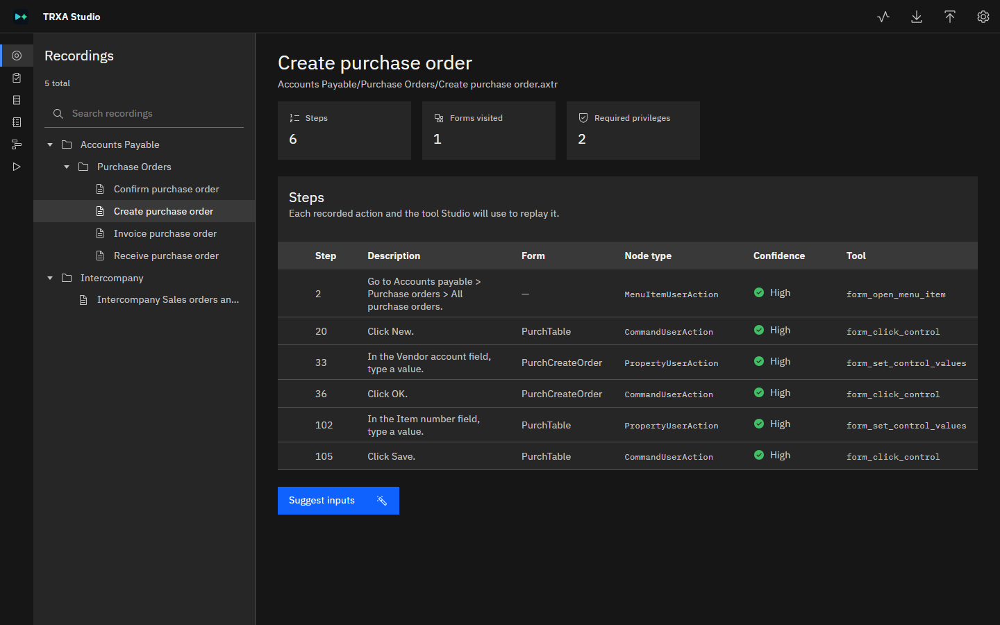

# TRXA-TOOL

TRXA-TOOL turns Dynamics 365 Finance and Supply Chain Management Task Recorder recordings (`.axtr`
files) into automated, data-driven regression tests that an AI agent replays against a test or
sandbox environment.

## How it works

1. **You record** a business process in Dynamics 365 with Task recorder, or export recordings from
   a Business Process Modeler library in Lifecycle Services.
1. **TRXA-TOOL prepares the test.** It translates each recording into steps that an agent can
   perform. In TRXA Studio, you then decide which values are test data, what the test checks, and
   how tests run in sequence.
1. **An AI agent runs the test.** GitHub Copilot CLI, Claude Code, or another agent that can use
   MCP tools works in Dynamics 365 through Microsoft's
   [Dynamics 365 ERP MCP server](https://learn.microsoft.com/dynamics365/fin-ops-core/dev-itpro/copilot/copilot-mcp).
   It performs each step, checks the results, and records whether each test passed or failed.
1. **You review the results** in TRXA Studio, and share them as text, Markdown or PDF.

TRXA-TOOL does everything that has a fixed answer, such as reading recordings, working out the run
order and passing data between tests. The agent does only the work that needs a live Dynamics 365
session.

## Get started

TRXA-TOOL comes in two forms. Both include TRXA Studio, and both can run tests with an AI agent.

| | Windows app | npm package |
|---|---|---|
| **Best for** | Consultants and testers who work in Studio | Developers and technical users who also want the command line |
| **Studio opens** | In its own window | In your browser |
| **`trxa` command in a terminal** | Through its full path | Yes |
| **Needs Node.js** | No | Yes, version 18.19 or later |
| **Platforms** | Windows | Windows, macOS, Linux |

- **Windows app**: download `TRXA-Studio-<version>-win-x64-portable.zip` (no installation) or
  `TRXA-Studio-Setup-<version>.exe` from the [Releases](https://github.com/elcanelo/trxa-tool/releases)
  page.
- **npm package**: run `npm install -g trxa-tool`, and then `trxa studio`.

For step-by-step instructions, including the agent and the Dynamics 365 connection, see
[Set up TRXA Studio for agent runs](SETUP.md).

> [!NOTE]
> The Windows app isn't code-signed yet. Windows SmartScreen might show **Windows protected your
> PC**, and a company-managed computer might block the app. [Step 1](SETUP.md#step-1-install-trxa-tool)
> of the setup article explains what to do.

## Documentation

| Article | Read it to |
|---|---|
| [Set up TRXA Studio for agent runs](SETUP.md) | Install TRXA-TOOL and an agent, and connect the agent to Dynamics 365. |
| [Use TRXA Studio](STUDIO.md) | Create test cases, fixtures, suites and plans, run them, and review the results. |
| [TRXA-TOOL manual](MANUAL.md) | Use the `trxa` command line, and look up the file formats. |

The npm package includes these articles. To find them, run `npm root -g` and open the `trxa-tool`
folder.

## Protect business data

A recording captures whatever was on the screen when it was made, including real account numbers,
amounts and names. Test scripts and suggested test inputs carry that data forward. Review anything
created from a real recording before you share it or commit it to source control. For guidance,
see [Data hygiene](MANUAL.md#data-hygiene) in the manual.

## Report a problem

To report a bug, or a recording that TRXA-TOOL can't handle, open an issue at
[github.com/elcanelo/trxa-tool/issues](https://github.com/elcanelo/trxa-tool/issues). Don't attach
recordings or test files that contain real business data.

## Source code

TRXA-TOOL is closed source for now. The product is still evolving, and keeping the source
private while new features are planned lets the design change without breaking promises to
contributors. This repository holds the documentation and the issue tracker.

Feedback is welcome. To report a problem or suggest a feature, open an
[issue](https://github.com/elcanelo/trxa-tool/issues).

## License

TRXA-TOOL is proprietary software. Its use is governed by the end-user license agreement in
[LICENSE](LICENSE).
