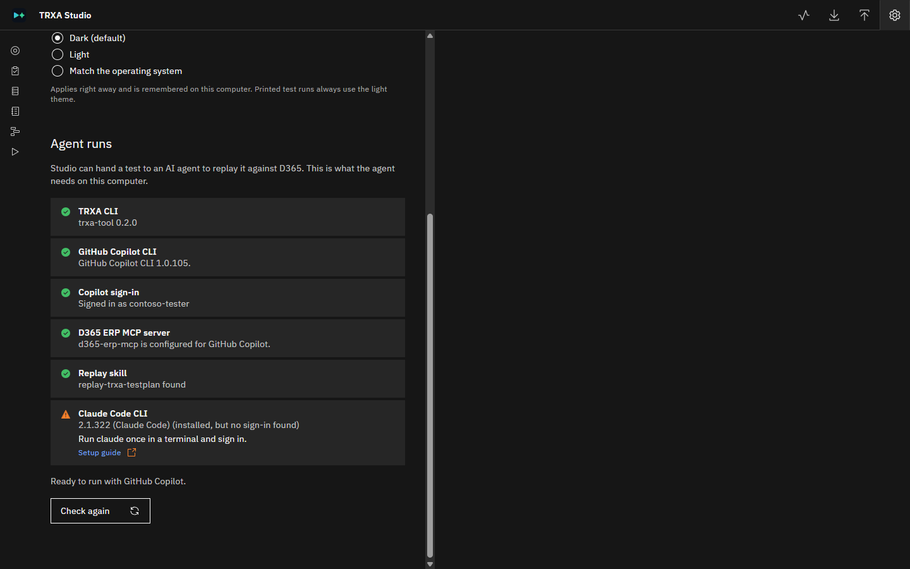

# Set up TRXA Studio for agent runs

This article explains how to install and configure everything TRXA Studio needs to replay tests
against Dynamics 365 Finance and Supply Chain Management (finance and operations apps) with an AI
agent. When you finish, **Settings** > **Agent runs** in Studio shows every item as ready, and the
**Run** button on test cases, suites and plans is available.

You can use Studio without completing every step. To build test cases, fixtures, suites and plans
from Task Recorder recordings, you only need [Step 1](#step-1-install-trxa-tool). Steps 2 through 7
are needed only to run tests with an AI agent.

## How the pieces fit together

An agent run involves four components on your computer and one in Dynamics 365:

| Component | What it does | Where you set it up |
|---|---|---|
| **TRXA-TOOL** | Studio, plus the `trxa` command that the agent uses to track and record each run. | [Step 1](#step-1-install-trxa-tool) |
| **An AI agent** | GitHub Copilot CLI or Claude Code. The agent reads each test step and performs it in Dynamics 365. | [Step 2](#step-2-install-an-agent) and [Step 3](#step-3-sign-in-to-the-agent) |
| **The Dynamics 365 ERP MCP server** | A Microsoft service, built into finance and operations apps, that lets an agent open forms, set values and read data. | [Step 4](#step-4-prepare-the-dynamics-365-environment) |
| **The MCP connection** | A setting in your agent that tells it how to reach your environment's MCP server. TRXA-TOOL provides a connector for this, `trxa mcp-bridge`. | [Step 5](#step-5-connect-the-agent-to-dynamics-365) |
| **The replay skill** | Instructions that teach the agent how to replay a TRXA test step by step. | [Step 6](#step-6-install-the-replay-skill) |

## Prerequisites

Before you begin, make sure that you have:

- A computer that runs Windows 10 or Windows 11. The npm package also runs on macOS and Linux, but
  this article shows Windows commands.
- A finance and operations apps environment that is **Tier 2 or higher**, or a **Unified Developer
  Environment**. The MCP server isn't supported on cloud-hosted environments (CHE).
- An environment version of **10.0.47** or later, **10.0.46 PQU-2**, or **10.0.45 PQU-7**.
- An account for one of the supported agents:
  - **GitHub Copilot CLI**: a GitHub account with a Copilot subscription.
  - **Claude Code**: a Claude subscription or an Anthropic API key.
- Help from a **Microsoft Entra ID administrator** and a **finance and operations system
  administrator** for [Step 4](#step-4-prepare-the-dynamics-365-environment), if you aren't one.

> [!IMPORTANT]
> Use a test or sandbox environment. A full run can save and post real records. Never connect an
> agent to a production environment for testing.

## Step 1: Install TRXA-TOOL

TRXA-TOOL is available in two forms. Both include Studio and both can run tests with an agent.

| | Windows app | npm package |
|---|---|---|
| **Best for** | Consultants and testers who work in Studio | Developers and technical users who also want the command line |
| **Studio opens** | In its own window | In your browser |
| **`trxa` command in a terminal** | Through its full path (see the note after this table) | Yes |
| **Needs Node.js** | No | Yes, version 18.19 or later |

> [!NOTE]
> The Windows app includes its own copy of the `trxa` command, in the `resources\cli` folder of the
> app. Studio uses it automatically during agent runs, so you don't need to install anything else.
> To use it from a terminal, run it by its full path, for example
> `"%LOCALAPPDATA%\Programs\TRXA Studio\resources\cli\trxa.cmd" --version`.

### Install the Windows app

1. Go to the [Releases](https://github.com/elcanelo/trxa-tool/releases) page and download one of
   these files from the latest release:
   - **Portable**: `TRXA-Studio-<version>-win-x64-portable.zip`. Nothing is installed. To update,
     replace the folder.
   - **Installer**: `TRXA-Studio-Setup-<version>.exe`. Installs for your user only, with a
     **Start** menu shortcut and an uninstaller. Administrator rights aren't needed. The default
     folder is `%LOCALAPPDATA%\Programs\TRXA Studio`.
1. If you downloaded the portable zip, right-click the file, select **Properties**, select
   **Unblock**, and then select **OK**. Extract the zip to a folder of your choice.
1. Start the app. For the portable version, run `TRXA Studio.exe` from the extracted folder.

The app isn't code-signed yet. If Windows SmartScreen shows **Windows protected your PC**, select
**More info**, and then select **Run anyway**. Unblocking the zip before you extract it usually
prevents this message.

> [!NOTE]
> On a company-managed computer, an IT policy might block unsigned apps. If Windows says **Access
> is denied**, or Microsoft Defender reports a blocked app, ask your IT team to allow TRXA Studio,
> or use the npm package instead.

### Install the npm package

1. Install [Node.js](https://nodejs.org) version 18.19 or later, if you don't have it.
1. Open a terminal and run:

   ```powershell
   npm install -g trxa-tool
   ```

1. Check the installation:

   ```powershell
   trxa --version
   ```

   The command prints `trxa-tool` followed by the version number.

1. Start Studio:

   ```powershell
   trxa studio
   ```

   Studio opens in your browser. To stop it, run `trxa studio stop`.

To update later, run `npm update -g trxa-tool`.

## Step 2: Install an agent

Studio can run tests with **GitHub Copilot CLI** or **Claude Code**. You need at least one of them.
GitHub Copilot CLI is the default agent in the **Run** dialog.

### Install GitHub Copilot CLI

GitHub Copilot CLI on Windows needs PowerShell 6 or later. Windows includes Windows PowerShell 5.1,
which isn't enough.

1. If you don't have PowerShell 7, install it:

   ```powershell
   winget install Microsoft.PowerShell
   ```

1. Open **PowerShell 7** (`pwsh`) and install GitHub Copilot CLI:

   ```powershell
   winget install GitHub.Copilot
   ```

1. Close and reopen the terminal, and then check the installation:

   ```powershell
   copilot --version
   ```

For other installation methods, see
[Installing GitHub Copilot CLI](https://docs.github.com/en/copilot/how-tos/copilot-cli/set-up-copilot-cli/install-copilot-cli).

### Install Claude Code

1. Open PowerShell and run the Claude Code installer:

   ```powershell
   irm https://claude.ai/install.ps1 | iex
   ```

1. Close and reopen the terminal, and then check the installation:

   ```powershell
   claude --version
   ```

For other installation methods, see
[Set up Claude Code](https://code.claude.com/docs/en/setup).

## Step 3: Sign in to the agent

An agent run starts the agent in the background, where it can't ask you to sign in. Sign in once
from a terminal before you start a run.

### Sign in to GitHub Copilot CLI

1. In a terminal, run:

   ```powershell
   copilot login
   ```

1. Copy the code that's shown, open the web page it names, paste the code, and approve the
   sign-in with your GitHub account.

### Sign in to Claude Code

1. In a terminal, run:

   ```powershell
   claude
   ```

1. Follow the prompts to sign in with your Claude account or an Anthropic API key.
1. When the sign-in is complete, type `/exit` to close Claude Code.

## Step 4: Prepare the Dynamics 365 environment

The agent works in Dynamics 365 through Microsoft's Dynamics 365 ERP MCP server. Your agent
connects with its own identity, a Microsoft Entra ID app registration, and Dynamics 365 runs every
request as the finance and operations user that you link to that identity.

> [!NOTE]
> These steps need administrator rights in Microsoft Entra ID and in finance and operations apps.
> If you aren't an administrator, send this section to the people who are.

### Confirm that the MCP server is turned on

1. In finance and operations apps, go to **System administration** > **Workspaces** > **Feature
   management**.
1. Find **Dynamics 365 ERP Model Context Protocol server** and confirm that it's enabled. It's
   enabled by default.

### Register an app in Microsoft Entra ID

1. Sign in to the [Microsoft Entra admin center](https://entra.microsoft.com).
1. Go to **Entra ID** > **App registrations**, and then select **New registration**.
1. Enter a name, for example `TRXA agent runs`. Leave the other settings at their defaults, and
   then select **Register**.
1. On the app's **Overview** page, copy these two values. You need them in Step 5:
   - **Application (client) ID**
   - **Directory (tenant) ID**
1. Go to **Certificates & secrets** > **Client secrets**, and then select **New client secret**.
1. Enter a description, choose an expiry, and then select **Add**.
1. Copy the secret's **Value** right away. Entra ID shows it only once.

For more information, see
[Register an application in Microsoft Entra ID](https://learn.microsoft.com/entra/identity-platform/quickstart-register-app).

### Link the app to a finance and operations user

1. In finance and operations apps, go to **System administration** > **Setup** > **Microsoft
   Entra ID applications**.
1. Select **New**.
1. In **Client ID**, enter the **Application (client) ID** from the app registration.
1. In **Name**, enter a name for the record.
1. In **User ID**, select the user that the agent acts as.

Choose the user carefully. The agent can do only what this user can do, and every record the agent
creates or changes is attributed to this user. Use a dedicated test user with the security roles
that your tests need. To exempt the agent's identity from a finance and operations user license,
also assign the **System agent** role to that user. The role grants no permissions by itself.

### Allow the app to use the MCP server

1. In finance and operations apps, go to **System administration** > **Setup** > **Allowed MCP
   clients**.
1. Select **New**, and then enter these values:

   | Field | Value |
   |---|---|
   | **Name** | A name for the connection, for example `TRXA agent runs` |
   | **ClientId** | The **Application (client) ID** from the app registration |
   | **Allowed** | Yes |

1. Save the record. The change can take up to one minute to take effect.

> [!NOTE]
> Microsoft bills MCP tool calls from agents other than Microsoft Copilot Studio at 0.1 Copilot
> Credits per tool call. Users with Dynamics 365 Finance Premium or Supply Chain Management Premium
> licenses are exempt. A single test run can make many tool calls. For details, see
> [Licensing](https://learn.microsoft.com/dynamics365/fin-ops-core/dev-itpro/copilot/copilot-mcp#licensing).

For more information about the MCP server, see
[Use Model Context Protocol for finance and operations apps](https://learn.microsoft.com/dynamics365/fin-ops-core/dev-itpro/copilot/copilot-mcp)
and [Security for Dynamics 365 ERP MCP](https://learn.microsoft.com/dynamics365/fin-ops-core/dev-itpro/copilot/mcp/mcp-security).

## Step 5: Connect the agent to Dynamics 365

Your agent reaches the MCP server through `trxa mcp-bridge`, a connector included in TRXA-TOOL. The
agent starts the connector when it needs Dynamics 365. The connector signs in with the app
registration from Step 4, and it recovers on its own from dropped sessions and short outages.

The connector reads four settings:

| Setting | Value |
|---|---|
| `D365_URL` | Your environment's address, for example `https://contoso.operations.dynamics.com` |
| `D365_TENANT_ID` | The **Directory (tenant) ID** from the app registration |
| `D365_CLIENT_ID` | The **Application (client) ID** from the app registration |
| `D365_CLIENT_SECRET` | The client secret **Value** from the app registration |

> [!IMPORTANT]
> Name the server `d365-erp-mcp`, exactly as shown in the following examples. The replay skill and
> the Studio readiness check look for that name.

If you use the Windows app without the npm package, replace `trxa` in the following examples with
the full path to the app's `trxa.cmd`, for example
`C:\Users\<you>\AppData\Local\Programs\TRXA Studio\resources\cli\trxa.cmd`.

### Connect GitHub Copilot CLI

1. Open `%USERPROFILE%\.copilot\mcp-config.json` in a text editor. If the file doesn't exist,
   create it.
1. Add a `d365-erp-mcp` entry under `mcpServers`, with your own values in `env`:

   ```json
   {
     "mcpServers": {
       "d365-erp-mcp": {
         "type": "local",
         "command": "cmd",
         "args": ["/c", "trxa", "mcp-bridge"],
         "env": {
           "D365_URL": "https://contoso.operations.dynamics.com",
           "D365_TENANT_ID": "<directory-tenant-id>",
           "D365_CLIENT_ID": "<application-client-id>",
           "D365_CLIENT_SECRET": "<client-secret-value>"
         },
         "tools": ["*"]
       }
     }
   }
   ```

   If the file already lists other servers, add only the `d365-erp-mcp` entry next to them.
   For the Windows app's full path, use `"args": ["/c", "C:\\Users\\<you>\\AppData\\Local\\Programs\\TRXA Studio\\resources\\cli\\trxa.cmd", "mcp-bridge"]`.
   In JSON, every backslash is written twice.

1. Save the file.

### Connect Claude Code

In a terminal, run the following command with your own values. Keep the options in this order: the
`-s user` option must come after the `-e` options.

```powershell
claude mcp add d365-erp-mcp -e D365_URL=https://contoso.operations.dynamics.com -e D365_TENANT_ID=<directory-tenant-id> -e D365_CLIENT_ID=<application-client-id> -e D365_CLIENT_SECRET=<client-secret-value> -s user -- cmd /c trxa mcp-bridge
```

Claude Code confirms with `Added stdio MCP server d365-erp-mcp`. The `-s user` option makes the
server available in every folder, including the working folder that Studio runs the agent in.

> [!IMPORTANT]
> These settings store the client secret as plain text in your user profile
> (`.copilot\mcp-config.json` or `.claude.json`). Don't share these files or commit them to source
> control. When the secret expires, create a new one in Entra ID and update the setting.

### Check the connection

Before you start a run from Studio, confirm that the agent can reach Dynamics 365:

1. Start the agent in a terminal (`copilot` or `claude`).
1. Ask: *"Use the d365-erp-mcp server to tell me which user and company I'm connected as."*
1. Confirm that the answer names the user from Step 4 and the environment you expect.

If the agent reports an error, see [Troubleshoot](#troubleshoot).

## Step 6: Install the replay skill

The replay skill, `replay-trxa-testplan`, teaches the agent how to replay a TRXA test: how to
perform each step, check expectations and record results. Install it in Studio's working folder.

To install it from Studio:

1. Select **Settings** (the gear icon in the upper-right corner).
1. In **Agent runs**, find the **Replay skill** row, and then select **Install skill**.

To install it from a terminal instead, go to your working folder and run:

```powershell
trxa init-skill
```

Both methods copy the skill into the working folder's `.claude\skills` folder, where GitHub Copilot
CLI and Claude Code find it, and into `.agents\skills` for other agents such as Codex.

## Step 7: Check that Studio is ready

1. In Studio, select **Settings**, and then go to **Agent runs**.
1. Select **Check again** to refresh the list.
1. Confirm that each item shows a green check mark. Under the list, Studio says which agent is
   ready, for example **Ready to run with GitHub Copilot.**



A yellow warning on **Claude Code CLI** is fine if you use GitHub Copilot, because Claude Code is
optional. Each item that isn't ready shows what to do next and a **Setup guide** link to the
matching step in this article.

You're ready to run a test. To learn how, see
[Run a test with an AI agent](STUDIO.md#run-a-test-with-an-ai-agent).

## Troubleshoot

Each row in **Settings** > **Agent runs** matches one part of this setup.

| Row | If it isn't ready |
|---|---|
| **TRXA CLI** | Studio can't find the `trxa` command. If you use the npm package, run `npm install -g trxa-tool`, and then restart Studio. The Windows app includes its own copy, so this row is ready there. See [Step 1](#step-1-install-trxa-tool). |
| **GitHub Copilot CLI** | Install it from PowerShell 7 with `winget install GitHub.Copilot`, and then restart Studio so that it finds the new command. See [Step 2](#step-2-install-an-agent). |
| **Copilot sign-in** | Run `copilot login` in a terminal. See [Step 3](#step-3-sign-in-to-the-agent). |
| **D365 ERP MCP server** | No server named `d365-erp-mcp` is configured for either agent. Check the name and the file location in [Step 5](#step-5-connect-the-agent-to-dynamics-365). The row also says which agents have it. An agent can run only if it has its own `d365-erp-mcp` entry. |
| **Replay skill** | Select **Install skill**, or run `trxa init-skill` in the working folder. If you changed the working folder, install the skill in the new folder too. See [Step 6](#step-6-install-the-replay-skill). |
| **Claude Code CLI** | Optional. To use Claude Code, install it and sign in. See [Step 2](#step-2-install-an-agent) and [Step 3](#step-3-sign-in-to-the-agent). |

### The agent can't connect to Dynamics 365

The connector writes its messages to the agent's MCP log. The most common causes are:

| Message or symptom | Cause and fix |
|---|---|
| `trxa mcp-bridge: set D365_URL, ... in the MCP server's "env" settings` | One or more settings are missing from the `env` section. Add all four. |
| `trxa mcp-bridge: D365_URL must start with https://` | Use the environment's full `https://` address. |
| Sign-in errors that mention `AADSTS` | The tenant ID, client ID or secret is wrong, or the secret expired. Check the values in Entra ID. |
| HTTP 401 or 403 from the environment | The app isn't linked to a user in **Microsoft Entra ID applications**, or its client ID isn't in **Allowed MCP clients** with **Allowed** set to **Yes**. Changes to **Allowed MCP clients** can take a minute. |
| The agent connects but can't open a form | The linked user lacks the security role for that form. Some administration forms are never available through the MCP server, such as **Feature management** and **Users**. |
| `'trxa' is not recognized` | The agent can't find the `trxa` command. Use the full path to `trxa.cmd`, as described in [Step 5](#step-5-connect-the-agent-to-dynamics-365). |

## Next steps

- [Use TRXA Studio](STUDIO.md): create test cases from recordings, build suites and plans, run them
  and review the results.
- [TRXA-TOOL manual](MANUAL.md): the full command-line reference.
