# Use TRXA Studio

TRXA Studio is the visual workspace for TRXA-TOOL. Use it to turn Dynamics 365 Finance and Supply
Chain Management Task Recorder recordings into automated tests, organize the tests into suites and
plans, run them with an AI agent, and review the results. You don't need to edit any files by hand.

Studio is available as a Windows app and as a browser page that the npm package starts. Both work
the same way. This article applies to both, except where a section says otherwise.

In this article, you learn how to:

- Start Studio and choose a working folder
- Create a test case from a recording
- Define what a test captures and checks
- Manage test data with fixtures
- Build suites and plans
- Run a test with an AI agent
- Review test runs

## Prerequisites

- TRXA-TOOL installed, either the Windows app or the npm package. For instructions, see
  [Step 1: Install TRXA-TOOL](SETUP.md#step-1-install-trxa-tool).
- One or more Task Recorder recordings (`.axtr` files). Record them in Dynamics 365 with Task
  recorder, or export them from a Business Process Modeler library in Lifecycle Services.
- To run tests with an AI agent: an agent and a connection to Dynamics 365. Complete every step in
  [Set up TRXA Studio for agent runs](SETUP.md).

## Key concepts

Studio works with seven kinds of records. Each one builds on the one before it.

| Record | What it is | Folder |
|---|---|---|
| **Recording** | A Task Recorder file (`.axtr`) that captures the steps someone performed in Dynamics 365. | `recordings` |
| **Test script** | The recording's steps, translated into actions that an agent can perform. Studio creates it for you. | `testscripts` |
| **Test case** | One business scenario that passes or fails, such as "Create purchase order". It defines the test's inputs, the values to capture (outputs) and the checks to make (expectations). | `testcases` |
| **Fixture** | A named set of test data, such as one company or one scenario. It holds input values for many test cases. | `testdata` |
| **Suite** | Test cases that run together, in an order you define. A suite also says where each test case gets its input values. | `suites` |
| **Plan** | A group of suites that run and report together, such as every suite for Accounts payable. | `plans` |
| **Test run** | The result of running a test case, a suite or a plan. | `testruns`, `runs` |

All records are files in Studio's *working folder*, so you can keep them in source control and use
them with the `trxa` command line too. For the file formats, see the [TRXA-TOOL manual](MANUAL.md).

## Start Studio

### Start the Windows app

- If you used the installer, open **TRXA Studio** from the **Start** menu.
- If you use the portable version, run `TRXA Studio.exe` from the folder where you extracted it.

The app opens in its own window. The first time, its working folder is `Documents\TRXA Studio`.

### Start Studio in your browser

1. Open a terminal in the folder that holds, or will hold, your recordings and tests.
1. Run:

   ```powershell
   trxa studio
   ```

   Studio starts in the background and opens `http://127.0.0.1:4321` in your browser. If Studio is
   already running, the command opens the browser page again instead of starting a second copy.

1. To stop Studio, run:

   ```powershell
   trxa studio stop
   ```

The first time Studio starts on a computer, the folder you ran `trxa studio` from becomes the
working folder. After that, Studio opens the working folder you last chose.

> [!IMPORTANT]
> Studio accepts connections only from your own computer, and it reads and writes files without
> asking you to sign in. Don't make it reachable from a network.

### Choose the working folder

The working folder is where Studio reads and writes all your records. To change it:

1. Select **Settings** (the gear icon in the upper-right corner).
1. In **Folder path**, enter the full path of the folder you want.
1. Select **Save**.

Studio switches to the new folder right away, without a restart.

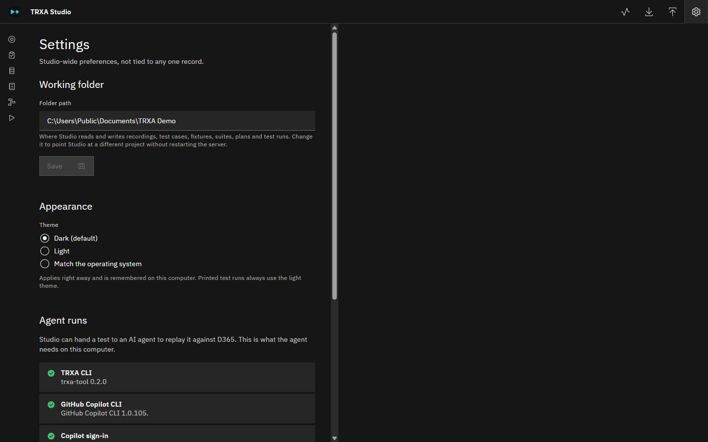

On the same page, **Appearance** sets the theme: **Dark**, **Light**, or **Match the operating
system**.

## Find your way around Studio

The rail on the left side opens each page:

| Page | Use it to |
|---|---|
| **Recordings** | Review a recording's steps and create a test case and fixture from it. |
| **Test Cases** | Edit a test case's outputs and expectations, and see which fixtures hold its data. |
| **Fixtures** | Create and edit sets of test data. |
| **Suites** | Arrange test cases in run order and connect their data. |
| **Plans** | Group suites, and see a combined result for each run. |
| **Test Runs** | Review the results of every run. |

The buttons in the upper-right corner are, from left to right:

- **Run activity**: shows the runs in progress and the most recent runs.
- **Export library**: downloads all your records as one zip file, for a backup or to move them to
  another computer.
- **Import library**: restores records from such a zip file.
- **Settings**: the working folder, the theme, and agent readiness.

Most pages share one layout: a searchable list on the left and the selected record on the right.
Each record opens with a **General** section that holds its name and description. Changes aren't
saved until you select **Save**, or press **Ctrl+S**. If you try to leave a page with unsaved
changes, Studio asks you first.

The address bar always reflects the page and record you have open. You can bookmark a record,
refresh the page, or use the browser's **Back** button, and Studio returns to the same place.

## Create a test case from a recording

Studio creates a test case, its test script and its first fixture values from a recording in one
step.

1. Copy your `.axtr` files into the working folder's `recordings` folder. You can use subfolders,
   for example one per business area.
1. Select **Recordings**, and then select a recording in the list.

   Studio reads the recording and shows its steps. For each step, the **Tool** column shows the
   action that the agent will use to replay it, and **Confidence** shows how sure Studio is about
   that action.

   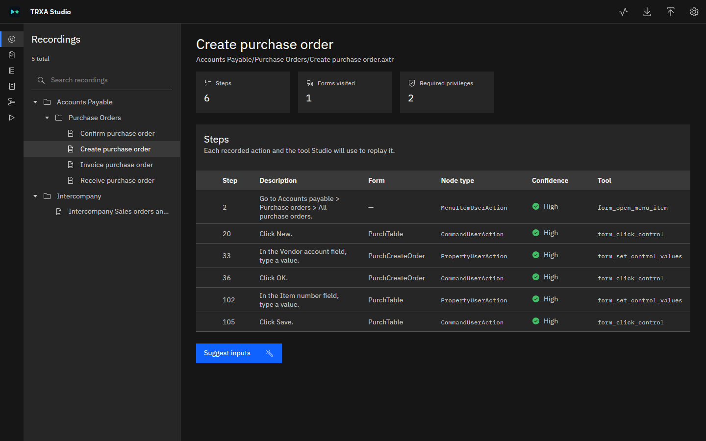

1. Select **Suggest inputs**. Studio finds the values that were typed or selected in the recording.
   These become the test case's *inputs*, the values that can change from one run to the next.
1. Select **Create test case & fixture**.
1. In the panel that opens, enter or check these values:

   | Field | Description |
   |---|---|
   | **Test case ID** | A short, unique ID, such as `create-purchase-order`. Studio uses it as the file name. |
   | **Test case name** | A readable name. Studio fills it in from the recording. |
   | **Description** | Optional. |
   | **Fixture name** | Select an existing fixture to add this test case's values to, or enter a new name to create a fixture. |
   | *One field per input* | The value to use for each input in this fixture. Studio fills them in from the recording. |

   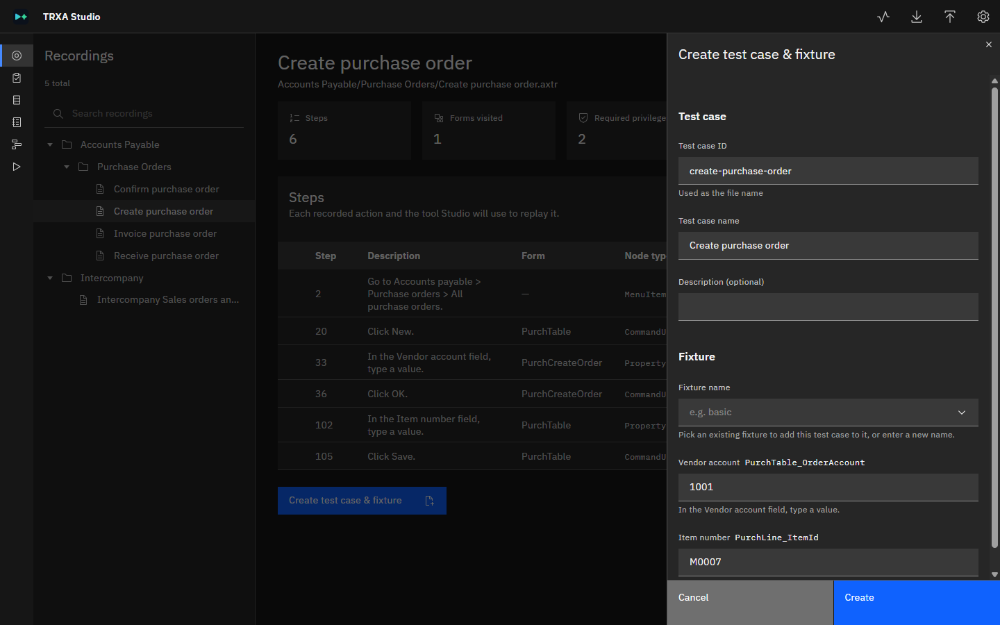

1. Select **Create**.

Studio creates the test case and a notification links to it.

> [!IMPORTANT]
> Input values come straight from the recording. If the recording was made with real business
> data, such as real vendor accounts or amounts, replace those values before you share or commit
> the fixture.

## Define what a test case captures and checks

A test case passes only if its *expectations* hold. It can also capture *outputs*, values that a
later test case in a suite needs, such as the number of a new purchase order.

Select **Test Cases**, and then select a test case. The page shows how many inputs, outputs,
expectations and steps it has, and four tabs:

- **Inputs** lists the test case's inputs. To use an input's value in a filter or an expected
  value, type its name in double braces, for example `{{vendorAccount}}`. Inputs come from the
  recording, so you change them on the **Recordings** page.
- **Outputs** and **Expectations** are described in the following sections.
- **Fixtures** lists the fixtures that hold values for this test case.

### Add an output

1. Select the **Outputs** tab, and then select **Add output**.
1. In **Output name**, enter a name. A suite refers to the output by this name.
1. Select an **Output kind**:
   - **OData** reads the value from a data entity. Enter the **Entity set**, a **Filter** that finds
     the record, and the **Field** to read. Use this kind when the record has a reliable business
     key to filter on.
   - **Form field** reads the value from the form after a step. Select the step in **After step**.
     Then select the control in **Control name**, or, if you don't know the control name, describe
     the value in **Hint**, for example "The new purchase order number shown after clicking New".
     During a run, the agent finds the control and fills in its name for later runs.
1. Select **Save**.

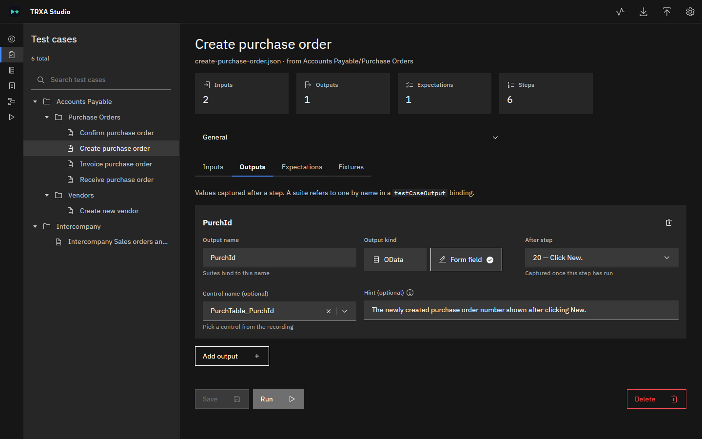

### Add an expectation

1. Select the **Expectations** tab, and then select **Add expectation**.
1. In **Description**, describe the check. The description appears in the test results.
1. Select the step in **Check after step**.
1. Select an **Expectation kind**:
   - **OData** queries a data entity and compares a field with a value. Enter the **Entity set**,
     **Filter**, **Expected field**, **Comparator** and **Expected value**.
   - **Message** checks the messages that Dynamics 365 showed. Select a **Severity**, and
     optionally enter text in **Message contains**. Leave it empty to match any message of that
     severity.
1. Select **Save**.

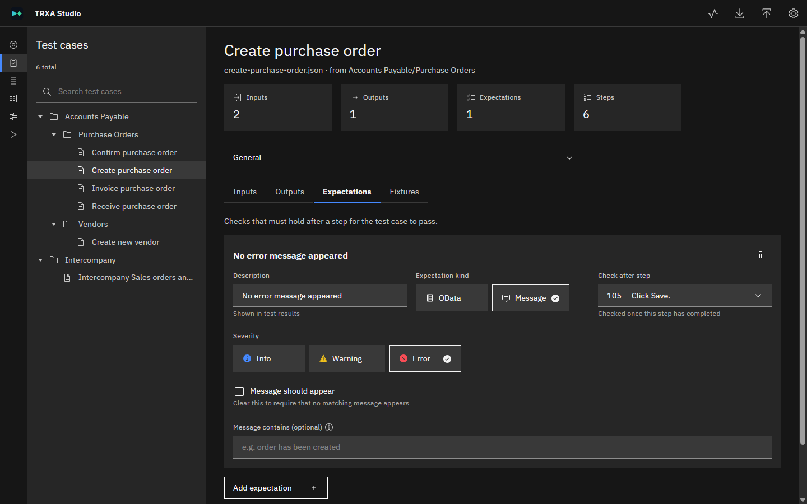

> [!TIP]
> To check that *no* error appeared, select **Severity** > **Error** and clear **Message should
> appear**. If you select **Message should appear**, the test passes only when an error *does*
> appear.

To delete a test case, select **Delete**. Studio deletes only the test case. Its test script stays,
because other test cases can share it, and any suite or fixture that refers to the test case keeps
the reference until you remove it.

## Manage test data with fixtures

A fixture is a named set of test data, such as one company or one scenario. It holds the input
values for every test case it covers. To run the same tests with different data, create another
fixture and choose it in the suite.

### Create a fixture

1. Select **Fixtures**, and then select **New fixture** (the plus icon above the list).
1. Enter a **Name** and, optionally, a **Description**. Suites refer to the fixture by its name.
1. Select **Create**. The new fixture opens.

### Add test cases and values

1. Select a fixture. The **Test cases** table lists each test case that the fixture holds values
   for, with how many values are set and a status, such as **Complete**.
1. To add test cases, select **Add test cases**, select one or more test cases, and then select
   **Add**.
1. To edit a test case's values, expand its row, and then enter the values. Required values are
   checked when you leave each field.
1. Select **Save**. Studio opens any row that still has a required value missing.

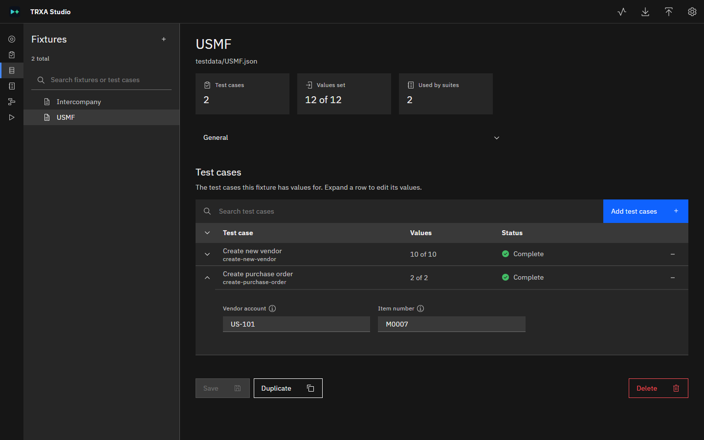

Other actions:

- **Remove from fixture** (the minus icon on a row) removes that test case's values. Studio names
  any suite that uses them.
- **Duplicate** copies the saved fixture, with all its test cases and values, under a new name.
- Renaming a fixture in **General** also updates every suite that uses it.
- **Delete** deletes the fixture. Studio names the suites that use it before you confirm.

> [!NOTE]
> Fixtures created by TRXA-TOOL 0.1 stored one test case per file. Studio shows those files as
> **(old format)** and opens them read-only. Select **Merge fixture files** to convert them. Studio
> makes no changes if two old files hold values for the same test case under the same fixture name.

## Build a suite

A suite runs test cases in order and passes data between them. For example, a purchase order suite
can create an order, then confirm, receive and invoice that same order.

### Create a suite

1. Select **Suites**, and then select **New suite** (the plus icon above the list).
1. Enter these values, and then select **Create**:

   | Field | Description |
   |---|---|
   | **File name** | The suite's file name, such as `purchase-order-lifecycle`. |
   | **Suite ID** | The ID that plans use to refer to the suite. |
   | **Name** | A readable name. |
   | **Description** | Optional. |

### Arrange test cases

The suite's canvas shows each test case as a box. Arrows show the order: a test case runs only
after every test case it depends on has passed.

1. In **Add a test case**, select a test case to add it to the canvas.
1. To make one test case depend on another, drag from the bottom handle of the first box to the top
   handle of the box that should run after it.
1. To remove a dependency, select its arrow, and then press **Delete** or **Backspace**.
1. Select **Save**.

You can drag the boxes to arrange them. The layout is saved only in your browser. To return to the
automatic layout, select **Reset layout**.

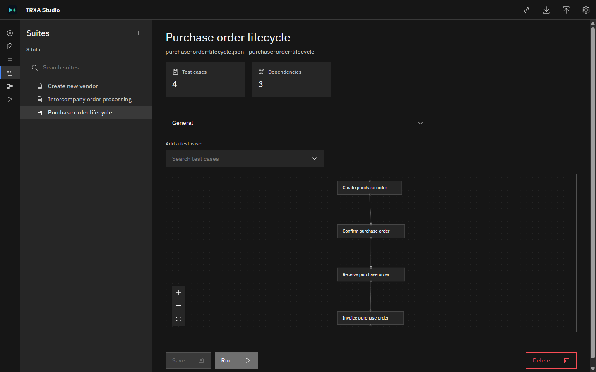

### Set up a test case in the suite

Point to a box and select its **Edit** icon to open its settings. To remove the test case from the
suite, select the **×** icon or **Remove from suite**.

| Setting | Description |
|---|---|
| **Legal entity** | Optional. The company to open the test case in. Leave it empty to stay in the current company. |
| **Depends on** | The test cases that must pass first. Select **×** on one to remove that dependency. |
| **Run condition** | Optional. In **Only run if**, select a dependency, one of its outputs, a comparator and a value. If the condition isn't met, the test case is *skipped*, which is neither a pass nor a failure. Test cases that depend on a skipped test case are *blocked*. |
| **Input bindings** | Where each input gets its value. See the following table. |

For each input, select a **Source**:

| Source | The value comes from |
|---|---|
| **Unbound** | Nowhere yet. A required input must be bound before the suite can run. |
| **Fixture value** | A fixture that holds values for this test case. |
| **Output of an upstream test case** | An output of a test case that runs earlier in the suite, such as the new purchase order number. |
| **Literal value** | A value that you type into the suite. Use it for constants, not for business data. |
| **Autogenerated** | The agent, which invents a value during the run. Use it for values that only need to be unique, such as a new vendor account. |

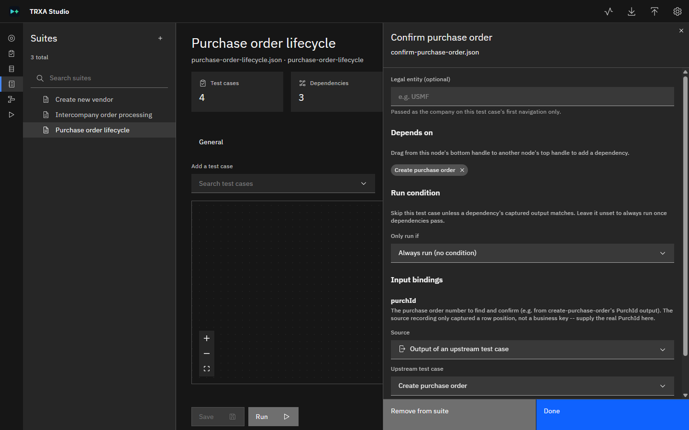

Select **Done** to close the panel, and then select **Save**. Studio checks the suite when you
save, for example for test cases that depend on each other in a loop.

## Group suites into a plan

A plan groups suites that you run and report on together. The suites in a plan don't share data
or depend on each other. If two suites need to share data, combine them into one suite.

1. Select **Plans**, and then select **New plan** (the plus icon above the list).
1. Enter a **File name**, **Plan ID**, **Name** and, optionally, a **Description**, and then select
   **Create**.
1. Select **Add suites**, select the suites to include, and then select **Add**.
1. Use the up and down arrows to set the run order, and the minus icon to remove a suite.
1. Select **Save**.

Under **Rollup status**, select a run in **Run** to see each suite's status and an **Overall**
result. A suite is *missing* if it hasn't run yet in that plan run, *incomplete* while it's
running, *failed* if any test case failed or was blocked, and *passed* otherwise. The **Overall**
result shows the worst status of any suite.

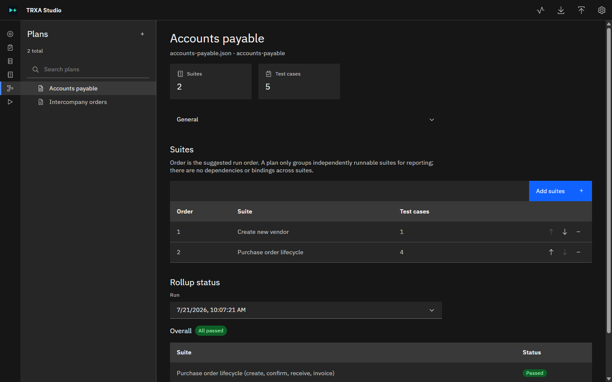

## Run a test with an AI agent

Test cases, suites and plans each have a **Run** button. It hands the item to an AI agent, which
replays it in Dynamics 365 through the MCP connection you set up.

Before you begin, complete [Set up TRXA Studio for agent runs](SETUP.md). If an item isn't ready,
the **Run** button is unavailable and an **Agent not ready** link opens **Settings**.

1. Open the test case, suite or plan, and then select **Run**.
1. In the dialog, enter these values:

   | Field | Description |
   |---|---|
   | **Run name** | How you find the run later. Studio starts with the item's name. Add what makes this run different, such as the update you're testing. |
   | **Agent** | **GitHub Copilot** or **Claude Code**. Only agents that are ready can run. |
   | **Expected environment** | The environment you expect the agent to be connected to, such as `contoso-sandbox`. |
   | **Expected company** | The company you expect, such as `USMF`. |
   | **How far to run** | **Navigation only** opens forms and reads values. Nothing is saved, posted, created or deleted. **Full run** performs every step, including saving and posting. |

   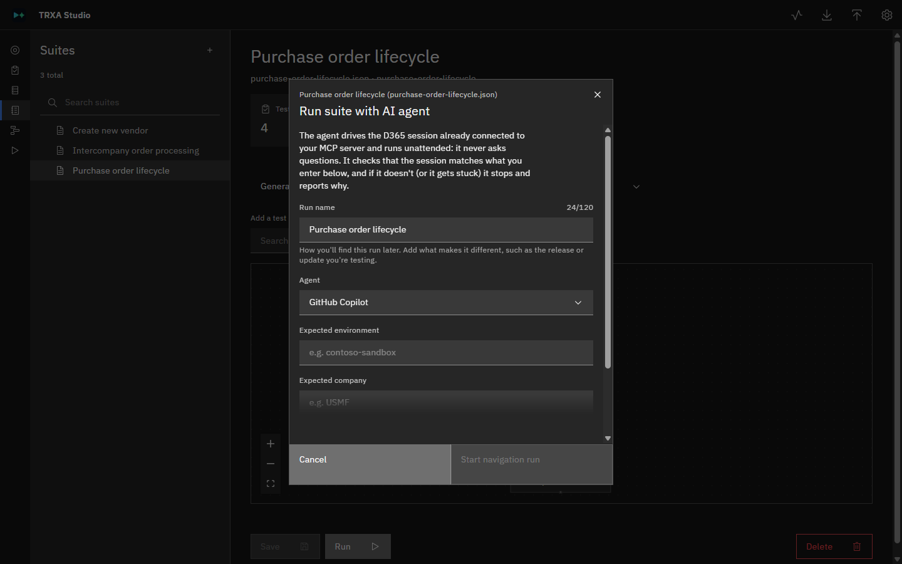

1. Select **Start navigation run** or **Start full run**.

Before it does anything else, the agent checks that it's connected to the environment and company
you entered. If they don't match, it stops and reports why. The agent runs unattended and never
asks questions.

> [!IMPORTANT]
> A full run creates, saves and posts real records in the connected environment. Selecting
> **Start full run** is your confirmation. Use a test or sandbox environment.

While the run is in progress:

- Studio opens the run's page in **Test Runs**, which updates as the agent works. To cancel the run,
  select **Stop run**.
- You can go to other pages. **Run activity**, in the upper-right corner, shows a progress bar for
  the run.
- When the run ends, a notification shows the result, with a **View run** link.

Only one agent run can be in progress at a time. During a run, the agent can't write files outside
the working folder or run shell commands other than `trxa`. Studio saves each run's transcript in
the working folder's `agent-runs` folder. It isn't sent anywhere except to the agent you chose.

## Review test runs

Select **Test Runs** to see every run: the test cases, suites and plans run from Studio, by an agent
in a terminal, or with the `trxa` command line.

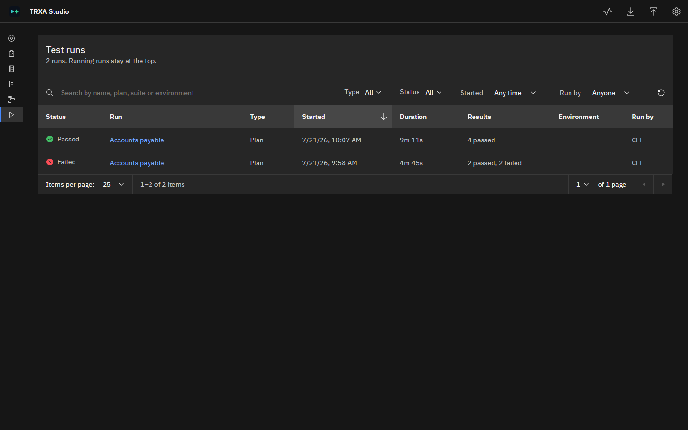

Each run is one row. A plan run includes its suites, and a suite run includes its test cases. Runs
in progress stay at the top. Use the search box and the **Type**, **Status**, **Started** and **Run
by** filters to find a run (an **Environment** filter appears once runs record one), and select a column heading to sort by it.

Select a run's name to open its page. The page shows the run's status, who ran it and how long it
took, a progress bar, and a summary of the results.

- For a plan run, expand a suite to see its test cases.
- Expand a test case to see its **Inputs**, captured **Outputs**, the **Assertions** that were
  checked (each with the value the agent observed), and the **Infolog** messages Dynamics 365 showed.
- Turn on **Show failures only** to hide the test cases that passed.

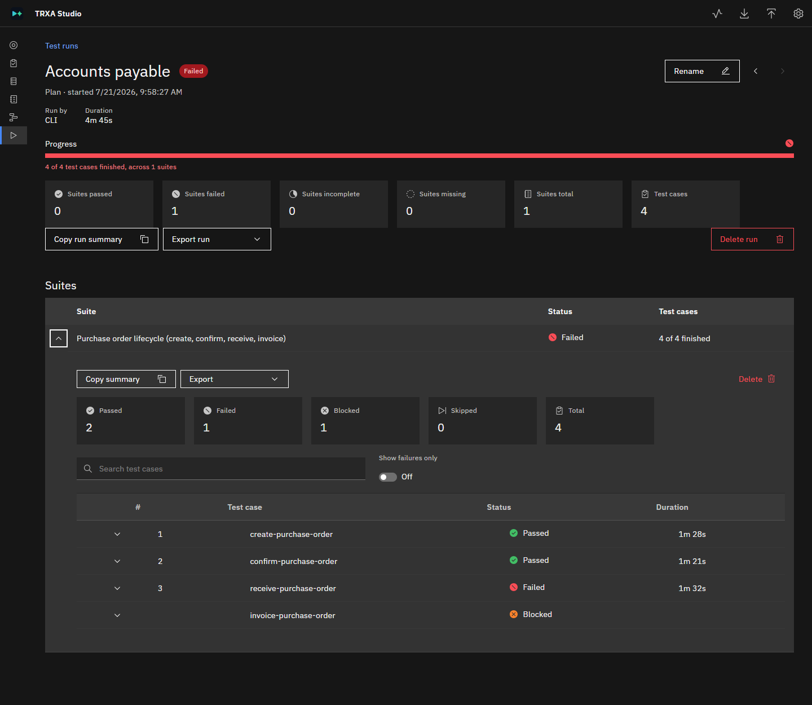

> [!NOTE]
> **Screenshot to add:** `media/studio/testrun-test-case.png`. A failed test case expanded on a
> run's page, showing the **Assertions** tab with a failed check and the observed value.

For a run started by an agent from Studio, the **Agent activity** tab shows what the agent did,
the reason if the run failed or was interrupted, and how many actions the run's permissions
blocked. Select **Full log** to download the complete transcript.

> [!NOTE]
> **Screenshot to add:** `media/studio/testrun-agent-activity.png`. The **Agent activity** tab of a
> run that an agent started from Studio.

To share results:

- **Copy run summary** copies the results as formatted text that you can paste into an email, a
  chat or a work item.
- **Export run** downloads the results as **Markdown (.md)**, or prints them to **PDF**.
- **Rename** changes the run's name.

A run's results are a record of what happened, so you can't edit them. To get new results, run the
test again. **Delete run** deletes a plan run's record. To delete one suite's results, use
**Delete** on that suite.

## Troubleshoot

| Problem | Solution |
|---|---|
| `trxa studio` reports that the port is in use | Run `trxa studio stop`, and then start Studio again. If the port is still in use, another program is using port 4321. To use a different port, set the `STUDIO_SERVER_PORT` environment variable before you start Studio. |
| A record you added outside Studio doesn't appear | Lists load when you open a page. Refresh the page. **Test Runs** refreshes on its own every few seconds. |
| A list shows **Invalid** for a file | The file doesn't match the expected format, and Studio can't open it. The message describes the problem. Fix the file in a text editor, or check it with the matching `trxa validate-...` command. |
| The **Run** button is unavailable | An item in **Settings** > **Agent runs** isn't ready. See [Troubleshoot](SETUP.md#troubleshoot) in the setup article. |
| A run fails right away with a sign-in or connection message | Sign in to the agent again (`copilot login`, or run `claude`), and check the MCP connection. See [Step 5](SETUP.md#step-5-connect-the-agent-to-dynamics-365). |
| A run shows as failed with the reason **interrupted** | Studio was closed or restarted while the run was in progress. Run the test again. |

## Related content

- [Set up TRXA Studio for agent runs](SETUP.md)
- [TRXA-TOOL manual](MANUAL.md): file formats and the `trxa` command line
- [Use Model Context Protocol for finance and operations apps](https://learn.microsoft.com/dynamics365/fin-ops-core/dev-itpro/copilot/copilot-mcp)
